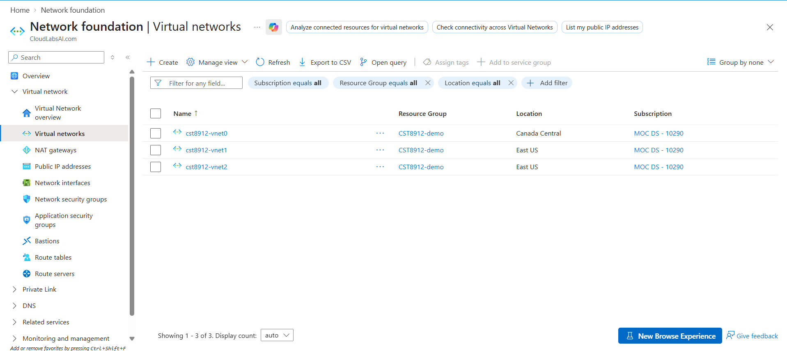
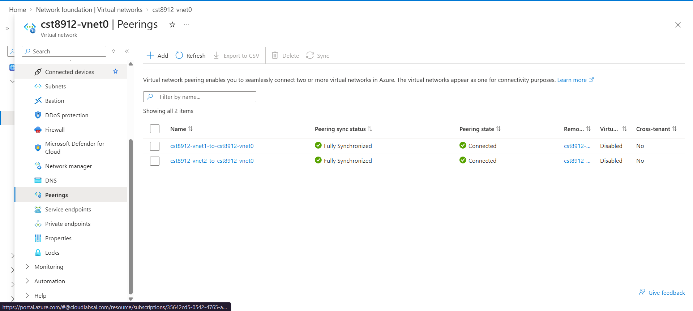
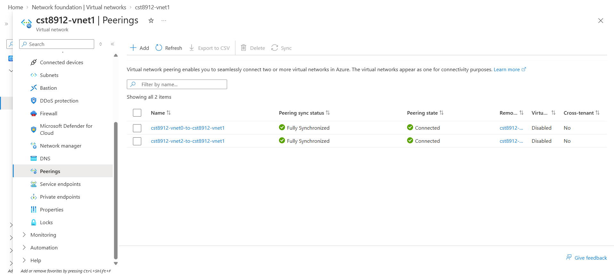
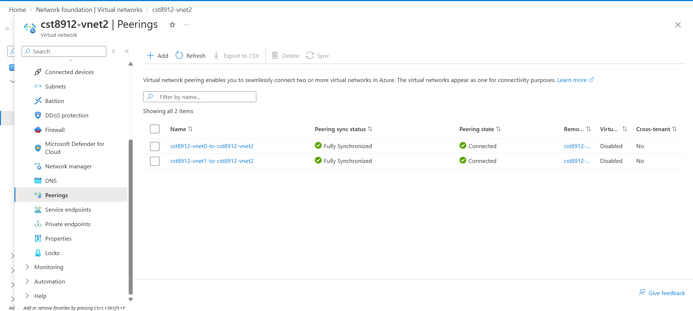
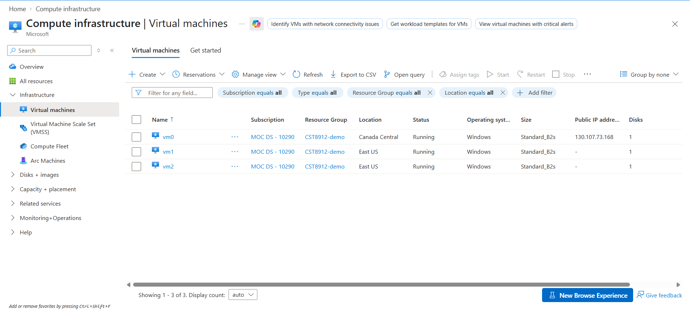
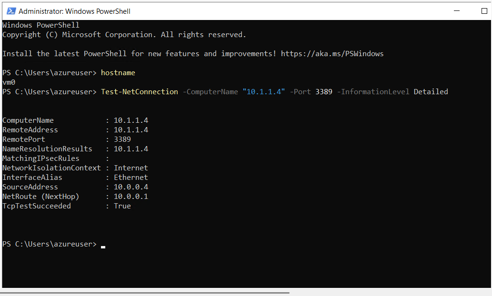
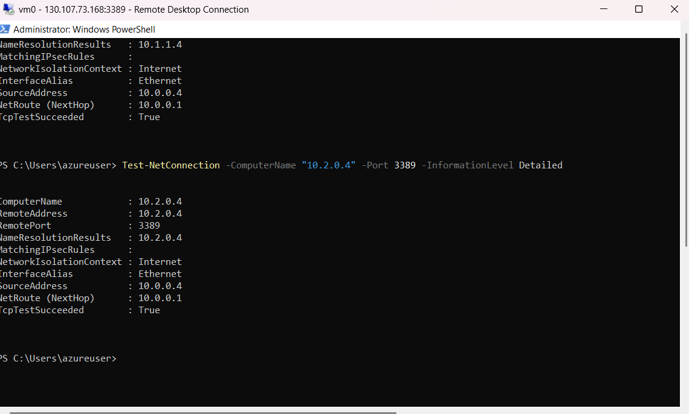
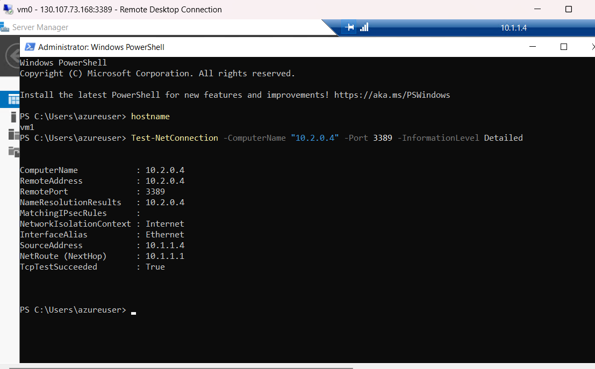
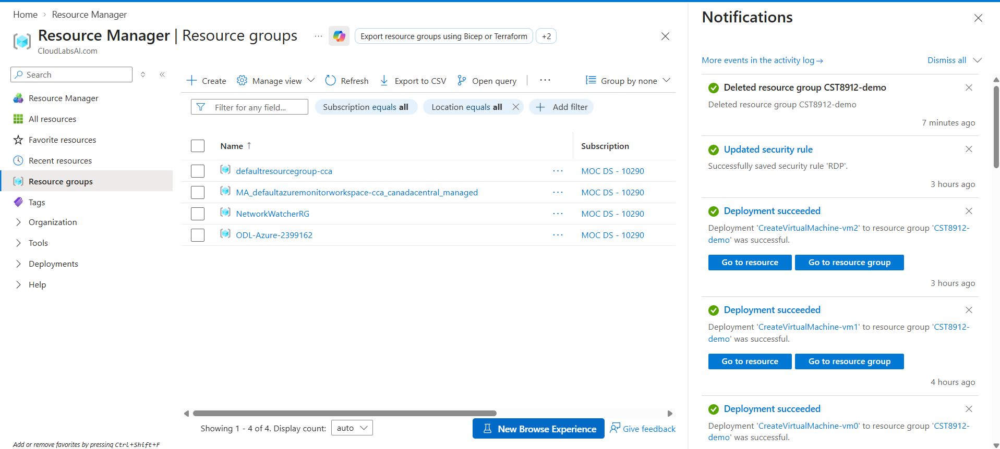

# CST8912 – Graded Lab Activity 2: Azure VNet Peering

**Name:** Samuel Vachon  
**Student Number:** 041101891  
**Section:** CST8912_013  
**Date:** October 8, 2026

## Purpose

The purpose of this lab was to configure local and global Azure VNet peering and test private connectivity between three virtual machines. I created three virtual networks in two regions, deployed one Windows VM in each network, and tested TCP port 3389 using private IP addresses.

## Selected Regions

| Region Label | Azure Region   |
| ------------ | -------------- |
| Region A     | Canada Central |
| Region B     | East US        |

Canada Central was used for cst8912-vnet0 and vm0. East US was used for cst8912-vnet1, cst8912-vnet2, vm1, and vm2.

## Resource Configuration

All resources were created in the resource group `CST8912-demo`.

| Virtual Network | Region         | Planned VNet Address Space | VM  | Recorded Private IP |
| --------------- | -------------- | -------------------------- | --- | ------------------- |
| cst8912-vnet0   | Canada Central | 10.0.0.0/16                | vm0 | 10.0.0.4            |
| cst8912-vnet1   | East US        | 10.1.0.0/16                | vm1 | 10.1.1.4            |
| cst8912-vnet2   | East US        | 10.2.0.0/16                | vm2 | 10.2.0.4            |

The lab specified default subnet ranges of 10.0.0.0/24, 10.1.0.0/24, and 10.2.0.0/24. The recorded address for vm1 was 10.1.1.4, which is outside the specified 10.1.0.0/24 subnet but within the planned 10.1.0.0/16 VNet address space. This is a configuration difference from the lab instructions; the exact deployed subnet range is not shown in the submitted screenshots.

All three VMs used Windows and the Standard_B2s size. vm0 had a public IP for the initial RDP connection. vm1 and vm2 had no public IP addresses.

### Screenshot: Virtual Networks



## VNet Peering Configuration

I configured peering between all three VNet pairs. Each pair has two directional links, giving six links in total.

| VNet Pair                     | Peering Type | Status                         |
| ----------------------------- | ------------ | ------------------------------ |
| cst8912-vnet0 ↔ cst8912-vnet1 | Global       | Connected / Fully Synchronized |
| cst8912-vnet0 ↔ cst8912-vnet2 | Global       | Connected / Fully Synchronized |
| cst8912-vnet1 ↔ cst8912-vnet2 | Local        | Connected / Fully Synchronized |

### Local Peering

Local peering connects virtual networks in the same Azure region. The connection between cst8912-vnet1 and cst8912-vnet2 is local peering because both networks are in East US.

### Global Peering

Global peering connects virtual networks in different Azure regions. The connections from cst8912-vnet0 in Canada Central to cst8912-vnet1 and cst8912-vnet2 in East US are global peerings.

### Non-Overlapping Address Spaces

Peered VNets must have non-overlapping address spaces so Azure can route traffic to the correct destination network. The planned address spaces were 10.0.0.0/16, 10.1.0.0/16, and 10.2.0.0/16.

### Screenshot: vnet0 Peerings



### Screenshot: vnet1 Peerings



### Screenshot: vnet2 Peerings



## Virtual Machines

The VM list confirmed that vm0, vm1, and vm2 were all running.

| VM  | Region         | Operating System | Size         | Status  |
| --- | -------------- | ---------------- | ------------ | ------- |
| vm0 | Canada Central | Windows          | Standard_B2s | Running |
| vm1 | East US        | Windows          | Standard_B2s | Running |
| vm2 | East US        | Windows          | Standard_B2s | Running |



## Private TCP Connectivity Tests

I connected to vm0 using Remote Desktop and ran PowerShell tests against the private IP addresses of vm1 and vm2. I then connected from vm0 to vm1 using its private IP and ran the final test inside vm1.

| Source VM | Source Private IP | Destination VM | Destination Private IP | TCP Port | TcpTestSucceeded |
| --------- | ----------------- | -------------- | ---------------------- | -------- | ---------------- |
| vm0       | 10.0.0.4          | vm1            | 10.1.1.4               | 3389     | True             |
| vm0       | 10.0.0.4          | vm2            | 10.2.0.4               | 3389     | True             |
| vm1       | 10.1.1.4          | vm2            | 10.2.0.4               | 3389     | True             |

### Test 1: vm0 to vm1

From PowerShell inside vm0:

```powershell
hostname
Test-NetConnection -ComputerName "10.1.1.4" -Port 3389 -InformationLevel Detailed
```

The result was `TcpTestSucceeded : True`. This confirms that vm0 could reach TCP port 3389 on vm1 through global VNet peering and the applicable security rules.



### Test 2: vm0 to vm2

From PowerShell inside vm0:

```powershell
Test-NetConnection -ComputerName "10.2.0.4" -Port 3389 -InformationLevel Detailed
```

The result was `TcpTestSucceeded : True`. This confirms that vm0 could reach TCP port 3389 on vm2 through global VNet peering. The output showed the source address as 10.0.0.4.



### Test 3: vm1 to vm2

After connecting to vm1 through the nested RDP session, I ran:

```powershell
hostname
Test-NetConnection -ComputerName "10.2.0.4" -Port 3389 -InformationLevel Detailed
```

The result was `TcpTestSucceeded : True`. This confirms that vm1 could reach TCP port 3389 on vm2 through local VNet peering.



### Interpretation

All three tests succeeded. The results demonstrate private TCP connectivity over port 3389 between the tested VM pairs. They do not measure application performance or confirm connectivity on every port.

## Troubleshooting and Configuration Differences

During vm1 creation, cst8912-vnet1 was not initially visible in the virtual network dropdown. The troubleshooting guidance was to check that the VM region matched the VNet region. The final screenshots show both vm1 and cst8912-vnet1 in East US.

Canada Central and East US were used instead of the document's validation examples. The lab allows students to select two different permitted regions.

All three VMs used Standard_B2s, so no VM size substitution was required. Windows was used for all tests, and no Ubuntu fallback was used.

The recorded vm1 private IP, 10.1.1.4, differs from the subnet specified in the lab. Despite this difference, all peerings were connected and all three private TCP tests succeeded.

## Cleanup

Cleanup is pending. After saving the evidence, the remaining steps are to close the RDP sessions, confirm that CST8912-demo contains only lab resources, delete the resource group, and verify that it no longer appears in the Resource groups list.

The cleanup screenshot will be saved as `09-cleanup.png`.



## Conclusion

This lab demonstrated local peering between two VNets in East US and global peering between Canada Central and East US. All six directional peering links were connected and fully synchronized. All three TCP connectivity tests returned True, confirming private reachability of port 3389 between the tested virtual machines.

## References

- [Manage Azure VNet peering](https://learn.microsoft.com/en-us/azure/virtual-network/virtual-network-manage-peering)
- [Create a Windows VM in the Azure portal](https://learn.microsoft.com/en-us/azure/virtual-machines/windows/quick-create-portal)
- [Test-NetConnection](https://learn.microsoft.com/en-us/powershell/module/nettcpip/test-netconnection)
